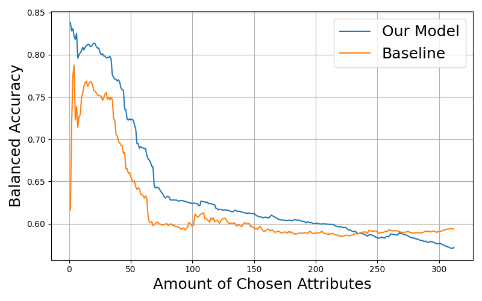
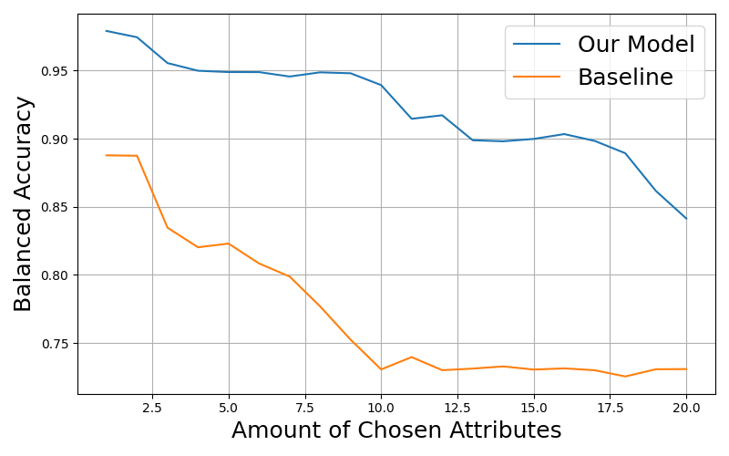
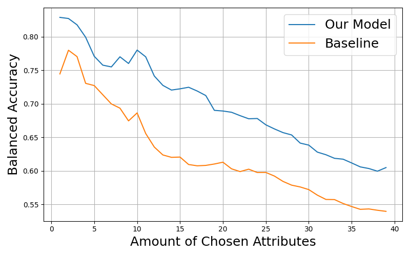
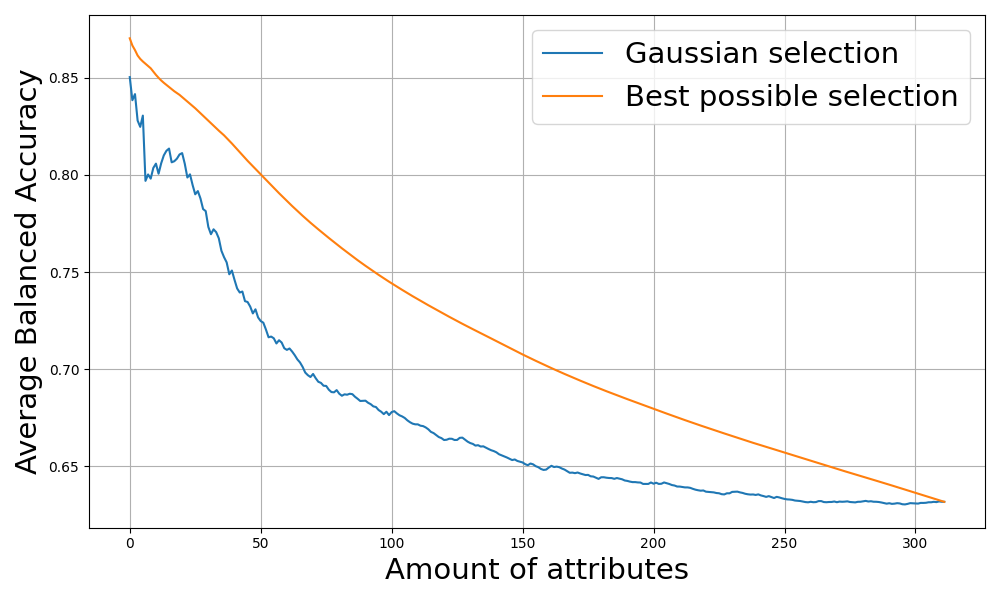
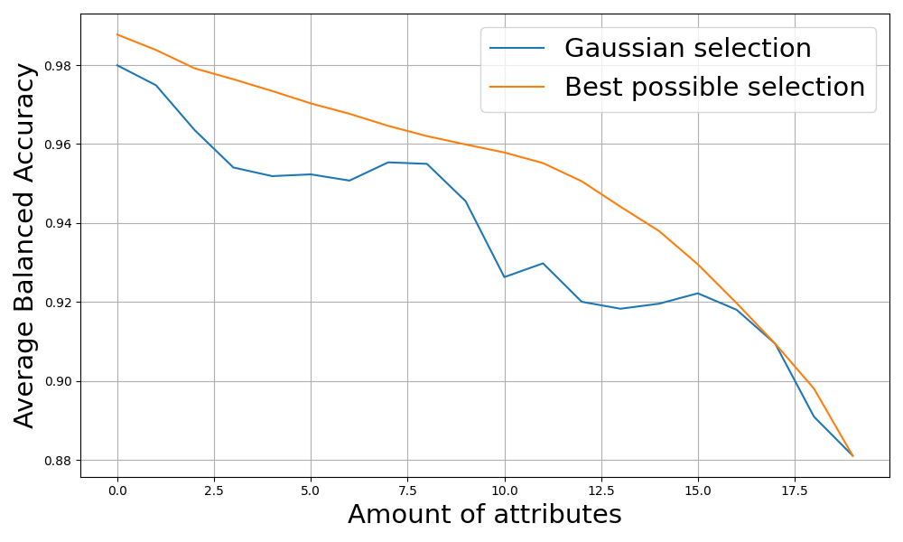
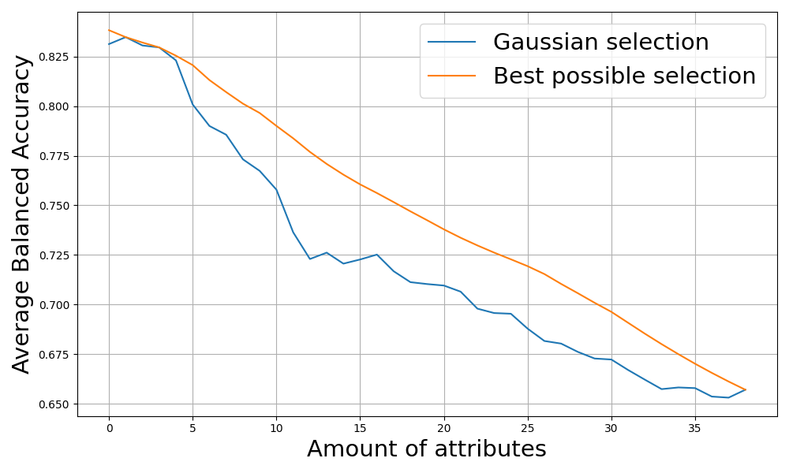
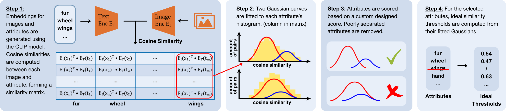

# Automatic concept labels with CLIP

Generates the yes/no concept labels that concept bottleneck models need, with CLIP and without any manual labelling: the Double Gaussian Approximation Method (DGAM).

## Result

DGAM beat the Stochastic-CBM labelling baseline on all three datasets.

| Dataset | Images | Concepts | Stochastic-CBM baseline | DGAM (ours) |
| --- | --- | --- | --- | --- |
| CUB-200-2011 | 11,788 | 312 | 75.8% | **81.4%** |
| CelebA | 50,000 | 39 | 61.3% | **68.9%** |
| Pascal VOC 2012 | 11,540 | 20 | 73.1% | **84.1%** |

Balanced accuracy of the generated labels against the ground truth, on the 20 concepts that DGAM selected. The baseline is evaluated on the same 20 concepts. The labels are only used to evaluate, never by the method itself. Rerunning `dgam/` on the team's stored CLIP similarities gives the same CUB and VOC scores and 69.9% for CelebA; the table shows the numbers from the report.

**Using every concept hurts.** Balanced accuracy as more concepts are added in DGAM's ranking order: on CUB it falls sharply beyond about 40 concepts, so choosing the concepts CLIP can actually see is essential.

| CUB | VOC | CelebA |
| --- | --- | --- |
|  |  |  |

**The ranking is close to the best possible one.** Average balanced accuracy of the top *x* concepts in DGAM's order, against the order you would get if you knew each concept's true accuracy. For VOC and CelebA the two curves nearly coincide; on CUB, DGAM finds the best concepts but orders the weaker ones less well.

| CUB | VOC | CelebA |
| --- | --- | --- |
|  |  |  |

## How it works



Concept bottleneck models explain a prediction through human-readable concepts, such as "the bird has blue wings". Training one needs a yes/no label for every image and concept: 10,000 images with 100 concepts is already a million labels. DGAM produces them automatically:

1. **Similarity.** Embed every image and every concept description with CLIP ViT-B/32 and compute their cosine similarity.
2. **Double Gaussian fit.** For each concept, fit two Gaussians to the histogram of similarities: one for "absent", one for "present". Penalty terms keep the fit plausible, and a refinement step re-fits the smaller Gaussian when it only models a tail.
3. **Concept ranking.** A score built from the fitted curves (distance between the means, height of their intersection, gain over a single Gaussian) measures how cleanly CLIP separates the concept. Poorly separated concepts are dropped.
4. **Thresholding.** Each kept concept gets its own threshold, chosen to maximise the balanced accuracy implied by its two fitted Gaussians.

**Baseline.** The method from the [Stochastic CBM paper](https://arxiv.org/abs/2406.19272) labels a concept as present when the image is more similar to the positive phrase ("has blue wings") than to its negation ("does not have blue wings").

## Other approaches we tried

**Supervised generalisation (report appendix A).** Could a network trained on some concepts label the others? We trained five models on CLIP image and concept embeddings, first with true labels and a random 40/30/30 split of the concepts. Balanced accuracy on the test concepts:

| Model | CUB | CelebA | VOC |
| --- | --- | --- | --- |
| (1) Neural network | 0.7449 | 0.6055 | 0.5296 |
| (2) Neural network with negative concept | 0.7099 | 0.5803 | 0.5010 |
| (3) Double input (positive and negative phrase as separate examples) | 0.7470 | 0.6137 | 0.5416 |
| (4) Two networks, positive and negative | 0.7441 | 0.6122 | 0.5533 |
| (5) Siamese network | 0.5890 | 0.5349 | 0.4801 |

Only CUB looked promising, so we tested it as an extension of DGAM: train on the concepts DGAM selected and labelled, then predict the rest. It did not generalise:

| Concepts in training set | (1) Neural network | (5) Siamese network |
| --- | --- | --- |
| 20 | 0.5366 | 0.4705 |
| 150 | 0.5757 | 0.4971 |
| 250 | 0.5653 | 0.5005 |

**LLM concept selection (report appendix B).** Can GPT-4o tell from the concept descriptions alone which concepts CLIP will recognise? We gave it two prompts and measured how well its choice separates good from bad concepts (ROC AUC against each concept's balanced accuracy; 0.5 is chance):

| Dataset | Prompt 1, run 1 | Prompt 1, run 2 | Prompt 2 |
| --- | --- | --- | --- |
| CelebA | 0.79 | 0.73 | 0.76 |
| CUB | 0.36 | 0.40 | 0.41 |

It worked for CelebA's simple facial attributes but not for CUB's fine-grained bird features, and repeating the same prompt gave different selections. DGAM, which looks at the data, is the more reliable choice. Prompts, selections and ROC curves are in [experiments/llm_concept_selection](experiments/llm_concept_selection).

## Quick start

Runs in a few seconds on a laptop, on synthetic CLIP-like similarities (no dataset download, no GPU):

```bash
git clone https://github.com/Magnus-DM/clip-concept-labelling.git
cd clip-concept-labelling
python3 -m venv .venv && source .venv/bin/activate
pip install -r requirements.txt

python -m dgam.synthetic                     # 40 concepts x 3,000 images -> data/similarities/SYNTHETIC
python -m dgam.evaluate --dataset SYNTHETIC  # fit, rank, threshold, report balanced accuracy
python -m dgam.plot --dataset SYNTHETIC      # results/*.png: accuracy vs. concepts, one fitted histogram
```

Tests: `pip install -r requirements-dev.txt && pytest`.

## Data

The datasets are not included. Download them and place them under `data/`:

| Dataset | Source | Expected layout |
| --- | --- | --- |
| CUB-200-2011 | [Caltech](https://www.vision.caltech.edu/datasets/cub_200_2011/) | `data/CUB_200_2011/{images.txt, images/, attributes/image_attribute_labels.txt}` |
| Pascal VOC 2012 | [VOC 2012](http://host.robots.ox.ac.uk/pascal/VOC/voc2012/) (trainval) | `data/VOC2012/{JPEGImages/, ImageSets/Main/}` |
| CelebA | [CelebA](https://mmlab.ie.cuhk.edu.hk/projects/CelebA.html) (aligned images + `list_attr_celeba.csv`, as on Kaggle) | `data/celebA/{list_attr_celeba.csv, Celebrity_Faces_Dataset/}` |

Then compute the CLIP similarities (step 1) and evaluate:

```bash
pip install -r requirements-clip.txt --extra-index-url https://download.pytorch.org/whl/cpu
python -m dgam.similarities --dataset VOC --data-root data/VOC2012
python -m dgam.evaluate --dataset VOC
```

As in the report, CelebA uses the first 50,000 images and 39 of its 40 attributes ("No Beard" is a negation, which CLIP handles poorly on its own). CUB uses the sentence versions of its 312 attributes in `concepts/cub_concept_phrases.txt`; VOC and CelebA use the attribute names.

## Project structure

```
dgam/                         clean implementation of the method
  similarities.py             step 1: CLIP cosine similarities per image and concept
  method.py                   steps 2-4: Gaussian fits, correction, concept score, threshold
  evaluate.py                 runs DGAM on all concepts, balanced accuracy for the top-k
  synthetic.py                synthetic similarities for the quick start and tests
  plot.py                     accuracy-vs-concepts curve and a fitted histogram
concepts/
  cub_concept_phrases.txt     the 312 CUB attributes rewritten as sentences
experiments/                  the team's original research scripts (see experiments/README.md)
  Gaussian.py, Mapping*.py    DGAM as run for the report
  negative_similarity.py      Stochastic-CBM baseline
  main.py, train.py, ...      supervised extension (appendix A)
  llm_concept_selection/      GPT-4o prompts, selections and ROC curves (appendix B)
  outputs/                    stored rankings, thresholds and per-concept accuracies
docs/                         figures from the report
tests/                        pipeline tests on synthetic data (run in CI)
```

`dgam/` gives the same scores and thresholds as `experiments/Gaussian.py` on the team's stored similarities; it drops the plotting, the commented-out variants and the hard-coded settings.

## Context

Project AI course, KU Leuven, spring 2025. Built as a team project with Lander Uyttenhove, Senne Stans and Yusuf Taskiran.

## References

- Radford et al. (2021). [Learning Transferable Visual Models From Natural Language Supervision](https://arxiv.org/abs/2103.00020) (CLIP; code: [openai/CLIP](https://github.com/openai/CLIP)).
- Vandenhirtz et al. (2024). [Stochastic Concept Bottleneck Models](https://arxiv.org/abs/2406.19272) (baseline).
- Oikarinen et al. (2023). [Label-Free Concept Bottleneck Models](https://arxiv.org/abs/2304.06129).
- Debot et al. (2024). [Interpretable Concept-Based Memory Reasoning](https://arxiv.org/abs/2407.15527).
- Wah et al. (2011). The Caltech-UCSD Birds-200-2011 Dataset. CNS-TR-2011-001.
- Everingham et al. The PASCAL Visual Object Classes Challenge 2012 (VOC2012).
- Liu et al. (2015). Deep Learning Face Attributes in the Wild. ICCV.

## License

MIT, see [LICENSE](LICENSE). The datasets and CLIP keep their own licenses.
